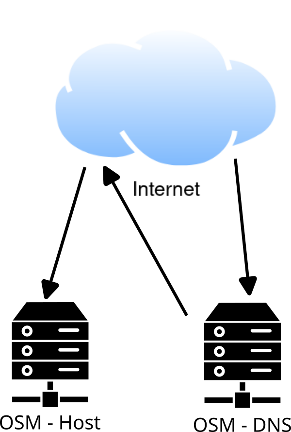
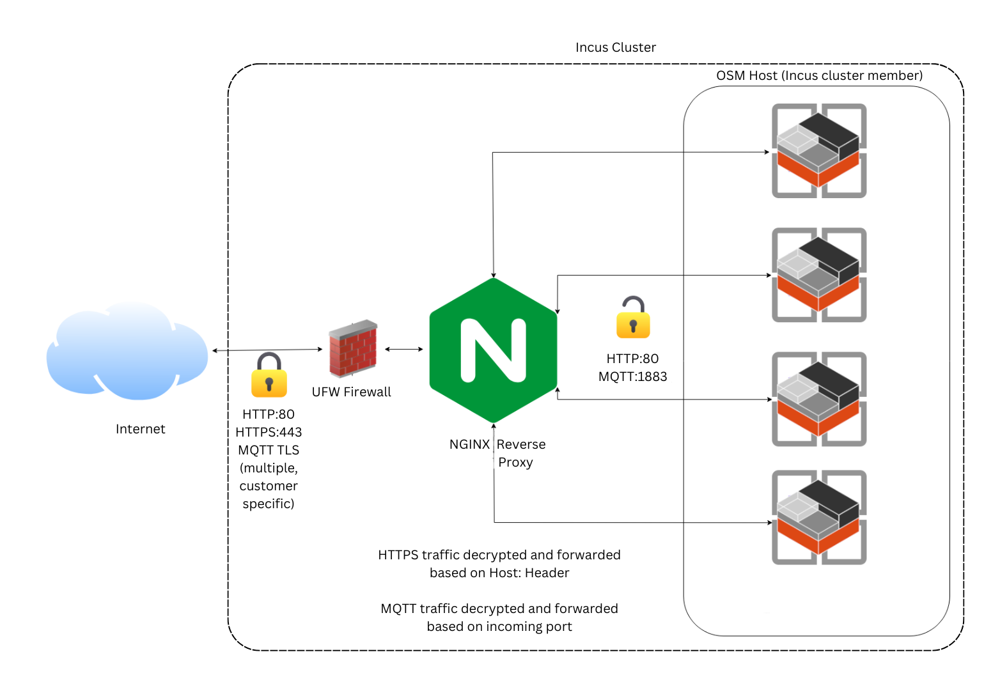

# Devtank Open Smart Monitor Hosting

## Overview

An OpenSmartMonitor (OSM) device sends data to a OSM customers container. The data is sent over MQTT over SSL encryption.

Different OSM customers containers are running on different servers. We call these servers OSM Hosts.
The domains of the address of the OSM customers is handled by a Devtank DNS server.
This will return the right server for the customer.

Each customer container may multiple domains to access different services.
Generally, these are:

- customer.osmm.devtank.co.uk
- customer-db.osmm.devtank.co.uk
- customer-chirpstack.osmm.devtank.co.uk

Where *customer* is the chosen customer name.
These domains correspond to the Grafana, database and Chirpstack web interfaces respectively.
The convention is to use a dash (-) where a space would naturally be.

So first there is a DNS lookup for which OSM Host the *customer* container is on.

<br><p align="center"></p>

Then that [OSM Host](./OSM-HOST.md) machine for that OSM *customer* is connected to and the connection is sent on to the *customer* container.

<br><p align="center"></p>


## Using Orchestrator

The Orchestrator talks to the databases which tracks which [OSM Host](./OSM-HOST.md) is used for which customer. These keeps the DNS updated and ensures OSM customers are spread across OSM Hosts according to the OSM Hosts capacity.

### Using Orchestrator

The orchestrator is used in the shell and used from within its folder.
You will need a "config.yaml" file setup for the MySQL of the PDNS and Orchestrator databases.
It is the format:

    {
        "orchestrator":
        {
            "user": "some_user",
            "password": "some_password",
            "host": "some_host",
            "database": "some_db"
        },
        "pdns":
        {
            "user": "some_user",
            "password": "some_password.",
            "host": "some_host",
            "database": "some_db"
        },
        "pdns_domain" : "osmm.some-domain.co.uk",
        "pdns_domain_id" : 1
    }

Once you have the config file in the orchestrator folder, you can see the comands with:

```sh
cd orchestrator
./orchestrator_cli.py
```

### Adding a customer with orchestrator

The orchestrator will deal with finding a OSM host with spare space, calling Ansible and updating the PDNS database.

```sh
cd orchestrator
./orchestrator_cli.py add_customer somecustomer
```

### Removing a customer with orchestrator

The orchestrator will deal with finding which OSM host the customer is on, and calling Ansible and updating the PDNS database.
```sh
cd orchestrator
./orchestrator_cli.py del_customer somecustomer
```

### Adding customer dashboards

Create self signed certificate with pebble
```sh
curl -s --cacert /srv/osm-lxc/utils/minica/devtank.minica.pem -o /tmp/rootCA.crt https://localhost:15000/roots/0
```

The orchestrator fills in the Grafana and Postgres credentials
but you must configure the dashboards for your collection of sensors
```sh
vim /srv/osm-lxc/lib/grafana_api_client/example_config.json
```

```
{
    "grafana_user"  : "",
    "grafana_pwd"   : "",
    "postgres_pwd"  : "",
    "postgres_user" : "",
    "postgres_db"   : "",
    "grafana_url"   : "",
    "pulse_div"     : "10.",
    "litre_multi"   : "1.",
    "dashboards"    : [
     {
         "location": "Example Location",
         "osm_name": "Example Loc",
         "serial_num": "404-101:E:A525040:0001:00001",
         "code": "COM1-A1-CT3",
         "topic": ""
     },
     {
         "location": "Example Location 2",
         "osm_name": "Example Loc 2",
         "serial_num": "404-101:E:A525040:0001:00099",
         "code": "COM1-A1-CT3",
         "topic": ""
     }
]
}
```

The "code" is a hyphen seperated string used to determine which json template Grafana loads for the sensor
```
COM1 = WiFi OSM
COM2 = LoRaWAN OSM
A1   = Environmental panels including air quality, temperature, humidity and volatile compound index
CT1  = Single phase current, electricity costs and power consumption panels
CT3  = 3 Phase current, electricity costs and power consumption panels
TMP2 = External temperature panel
RID  = MODBUS power consumption, voltage, costs and three phase current panels
VIB  = Singular vibration probe panels
VI2B = Multiple vibration probe panels
NOX  = Nitrogen oxide panel
CNT1 = Gas consumption panels
CNT2 = Water consumption panels
```

Run orchestrator command to add dashboards
```sh
/srv/osm-lxc/orchestrator/orchestrator_cli.py -d add_dashboards <customer_name> /srv/osm-lxc/lib/grafana_api_client/example_config.json /tmp/rootCA.crt
```

### Test environment

It is possible to build OSM test environment for development/testing purposes.
To do so, just execute ```<root of devtank sources>/orchestrator/env/run.bash -a setup -c network.cfg``` command. The script will prepare a network of virtual machines with the Devtank OSM eco-system.

The list of mandatory variables in network.cfg configuration file is the following:

- *HOSTS_DIR* - directory in Devtank sources directory where VMs configuration files are saved
- *VOSM_HOSTBR* - bridge network interface for VMs communication
- *OSM_SUBNET* - 3 octets of IPv4 address which will be used for environment network
- *HTTP_PORT* - port for temporary spawned web serves which is needed for installation of Debian OS
- *OSM_DOMAIN* - domain name

#### Testing
The [bats](https://bats-core.readthedocs.io/en/stable/) testing framework is used for testing Devtank OSM infrastsucture functionality. The `<root of devtank sources>/orchestrator/env/tests/customers.bats` contains tests suite.

Run `export JENKINS_DOMAIN=<domain name>; TERM=xterm bats -p --print-output-on-failure --verbose-run -T <root of devtank sources>/orchestrator/env/tests/customers.bats` command to execute tests.

## History

This is an evolution of the third iteration of this kind of hosting.

* **Version 1** was everyone on the same Grafana, Influx, Mosquitto and ChirpStack.
This had a few issues.
It was too scary to have all the eggs in one big basket.
We found we wanted to update the stack of some customers, but not others. Also, we found ourselves needing to do custom Grafana plugins for some but not others.
Additionally, we found customers wanted to know they were isolated from others.

* **Version 2** was Docker based, behind an Apache reverse proxy and stunnel4, but we didn't want the mess/bloat of 4+ Dockers per customer, so made Docker be multiple service, and found ourselves against the grain of Docker.

* **Version 3** was LXC based using NGINX. Originally only supporting a single VPS, but interated to be multiple VPs with PDNS and the Orchestrator.

* **Version 4** was migrated from LXC to Incus. Each OSM Host is a member of Incus cluster.
