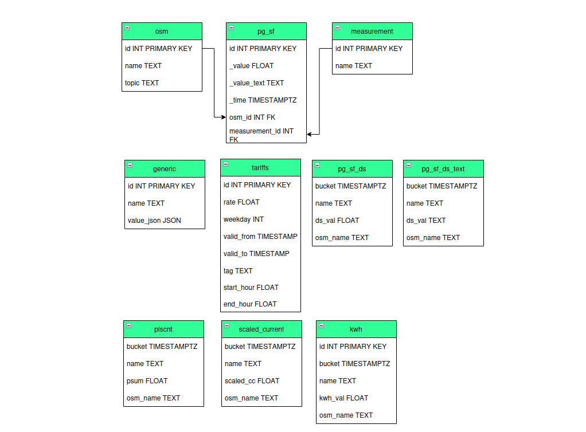

# Database Schema

The image above shows our database schema.

The table 'osm' stands for OpenSmartMonitor and stores information about the sensor, 'pg_sf' contains
a value, timestamp and has foreign keys linked to a sensor and measurement.

The table 'tariffs' stores information related to utility bills which is used in cost calculations for electricity, gas and water consumption.

There are several tables which contain downsampled data from 'pg_sf', these include 'pg_sf_ds',
'pg_sf_ds_text', 'plscnt', 'scaled_current' and 'kwh'.

# Measurements

See below the list of measurements and their descriptions:

|  Measurement  |  Description  |
| ------------- |:-------------:|
| FW        | Git SHA1 of firmware     |
| CREV      | How many times config has been changed     |
| PM10      | Particulate matter less than 10 micrometres in diameter     |
| PM25      | Particulate matter less than 2.5 micrometres in diameter     |
| PM4       | Particulate matter less than 4 micrometres in diameter     |
| PM1       | Particulate matter less than 1 micrometres in diameter     |
| CC1       | Electrical current from external Current Clamp / Current Transformer in mA     |
| CC2       | Electrical current from external Current Clamp / Current Transformer in mA     |
| CC3       | Electrical current from external Current Clamp / Current Transformer in mA     |
| TMP2      | External 1Wire probe temperature    |
| TMP3      | External 1Wire probe temperature     |
| CNT1      | Pulse count for water or gas flow meters     |
| CNT2      | Pulse count for water or gas flow meters     |
| LGHT      | Illuminance in Lux     |
| SND       | Noise level in Decibels, A weighted (dBA)     |
| FTA1      | Four to Twenty Milli Amps, i.e. 4-20mA     |
| FTA2      | Four to Twenty Milli Amps, i.e. 4-20mA     |
| FTA3      | Four to Twenty Milli Amps, i.e. 4-20mA     |
| FTA4      | Four to Twenty Milli Amps, i.e. 4-20mA     |
| HUM2      | Relative Humidity from OSM_SENxx chip     |
| TMP5      | Temperature from OSM_SENxx chip     |
| VOC       | Volatile organic compounds from SENxx.     |
| NOX       | Nitrogen Oxide from SENxx.     |
| CO2       | Carbon Dioxide from SENxx.     |
| HCHO      | Formaldehyde from OSM_SENxx     |

# PostgREST API

It is possible to make API calls to the database using the PostgREST API which is served at the endpoint
https://customername-db.osmm.devtank.co.uk.

## Examples

Retrieving all data from 'tariffs':

`curl https://customername-db.osmm.devtank.co.uk/tariffs -H "Authorization: Bearer $API_TOKEN"`

Retrieving a days worth of temperature data from the downsampled table.

`curl "https://customername-db.osmm.devtank.co.uk/pg_sf_ds?name=eq.TMP5&bucket=gt.2025-09-08T00:00:00&bucket=lt.2025-09-09T00:00:00" -H "Authorization: Bearer $API_TOKEN"`
